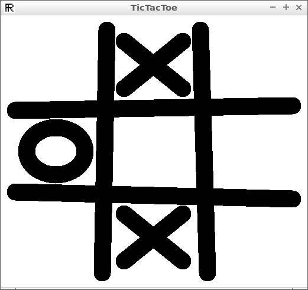
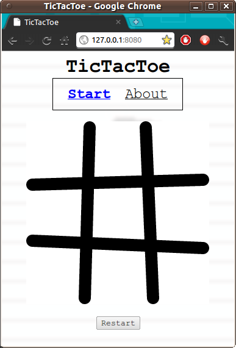
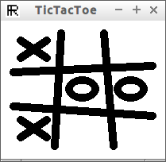

# Tic-Tac-Toe

Tic-Tac-Toe is one of [Richèl Bilderbeek's games](https://richelbilderbeek.github.io/games/).

The game Tic-Tac-Toe, written in C++.

## Screenshots

## Links

- [Source code](https://github.com/richelbilderbeek/TicTacToe)
